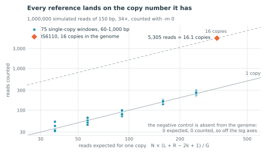
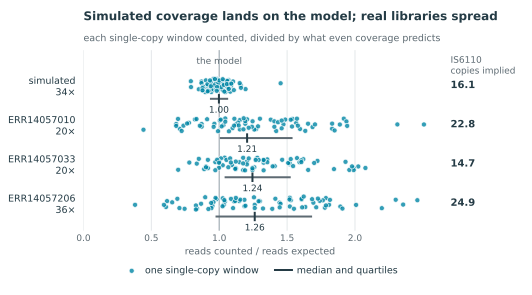

# Validation

Everything on this page is produced by
[`validation/run_validation.sh`](https://github.com/duceppemo/seqcounter/blob/main/validation/run_validation.sh),
which downloads about 150 MB of public data and takes a few minutes:

```bash
bash validation/run_validation.sh
```

The figures below are drawn from those same results by
[`validation/make_figures.py`](https://github.com/duceppemo/seqcounter/blob/main/validation/make_figures.py), so
they change with the data and not by hand.

It checks what seqcounter counts against counts that are known independently: in an assembly, in reads simulated
from that assembly, and in three public read sets.

## The data

| | |
| --- | --- |
| Genome | *Mycobacterium tuberculosis* H37Rv, [NC_000962.3](https://www.ncbi.nlm.nih.gov/nuccore/NC_000962.3), 4,411,532 bp, one contig |
| Multi-copy reference | IS6110, [X17348.1](https://www.ncbi.nlm.nih.gov/nuccore/X17348.1), 1,360 bp |
| Single-copy references | 75 windows of the genome, 60 to 1,000 bp |
| Negative control | 300 bp of random sequence |
| Reads | 1,000,000 simulated at 34×, and [ERR14057010](https://www.ebi.ac.uk/ena/browser/view/ERR14057010), [ERR14057033](https://www.ebi.ac.uk/ena/browser/view/ERR14057033), [ERR14057206](https://www.ebi.ac.uk/ena/browser/view/ERR14057206) from the ENA |

Nothing here is taken on trust. The copy number of IS6110 is **measured**, not quoted: each of its k-mers is
looked up in the genome, and the median k-mer occurs **16 times**, which is the accepted copy number for H37Rv. The
single-copy windows are kept only when **every** one of their k-mers occurs exactly once in the genome, on either
strand, so their copy number is one by construction; 75 of 84 candidate windows passed.

## 1. In an assembly, a reference is counted once

```
76 reference(s) counted 1
1 reference(s) counted 0
```

Every reference present is counted **once** in the one-contig assembly, IS6110 included, although it is there 16
times. The one counted 0 is the negative control. This is the behaviour described in
[How it works](How-it-works): in fasta input the count is the number of sequences containing the reference, not the
number of copies.

## 2. The counts are exactly the reads that share a k-mer

The strongest check available: count the same 200,000 reads twice, once with seqcounter and once with a plain
Python scan that takes every k-mer of every reference and asks which reads contain one.

```
200,000 reads scanned in Python against 77 references
identical for every reference, including IS6110 (1,095 reads) and the control (0)
```

Not close — **identical**, for all 77 references. With `-m 0` seqcounter counts exactly the reads that share a
k-mer with each reference, with nothing added and nothing dropped.

## 3. With even coverage, the counts follow the copy number

A read of length R matches a reference of length L when it overlaps one of its copies by at least k bases, which is
true for L + R − 2k + 1 of the G start positions in the genome. So N reads should give

> count = N × copies × (L + R − 2k + 1) / G

On 1,000,000 simulated reads of 150 bp with 0.2% sequencing errors (34×), counted and divided by that prediction:

| | windows, median | quartiles | IS6110 counted | copy number implied | control |
| --- | --- | --- | --- | --- | --- |
| `-m 0` | **1.00** | 0.93–1.07 | 5,305 | **16.1** | 0 |
| `-m 1` | 1.02 | 0.94–1.08 | 5,312 | 15.8 | 0 |

<p align="center">
  <picture>
    <source media="(prefers-color-scheme: dark)" srcset="https://raw.githubusercontent.com/duceppemo/seqcounter/main/assets/validation_model_dark.svg">
    
  </picture>
</p>

*Each point is one reference: what it was counted, against what the model expects for a single copy. The windows
come in five lengths, so they stack in five columns; the vertical scatter inside a column is the sampling noise of
a few hundred reads. The lines are not fitted — they are the model at one copy and at sixteen.*

The 75 single-copy windows, which span a 17-fold range of lengths, land on the prediction with a median of 1.00.
IS6110's count, divided by the rate of a single copy in the same sample, gives **16.1 copies** where the genome has
16. The length term and the copy-number term of the model are therefore both right, and the tool measures what the
model describes.

## 4. What `-m 1` costs

Allowing one mismatch per k-mer is the default, because a single sequencing error otherwise destroys a k-mer. It is
not free: a k-mer within one substitution of a reference k-mer may sit somewhere else in the genome entirely. On
the same simulated reads:

```
22 of 77 references counted more reads with -m 1 than with -m 0
single-copy windows: median +0.0%, worst +43.0%
  w300_5                79 -> 113     +43%
  w1000_59             258 -> 321     +24%
  ...
  the control stays at 0
```

Most references are unaffected — the median window gains **nothing** — but a minority gain a fifth to nearly half
of their count from near-matches elsewhere in the genome. Tracing one such case: a 1,000 bp window whose exact
count was 64 rose to 99 with `-m 1`, and the genome holds 16 positions, in 7 clusters, whose k-mers sit one
substitution away from one of that window's k-mers. The reads over those seven places account for the difference.

So `-m 1` buys tolerance to sequencing error and pays in specificity, by an amount that depends on the reference
and the genome, not on a general rule. If a count matters, run it both ways: a reference whose count barely moves
has no near-matches to worry about. The negative control stayed at 0 under both settings, in every run on this
page.

## 5. On real reads, coverage is not even

The same reference set, on three public read sets of *M. tuberculosis*:

| run | reads | depth | windows, median | quartiles | IS6110 counted | copy number implied | control |
| --- | --- | --- | --- | --- | --- | --- | --- |
| ERR14057010 | 599,360 | 20.1× | 1.21 | 1.00–1.54 | 5,442 | 22.8 | 0 |
| ERR14057033 | 586,752 | 19.7× | 1.24 | 1.04–1.53 | 3,550 | 14.7 | 0 |
| ERR14057206 | 1,055,736 | 35.6× | 1.26 | 0.97–1.68 | 10,994 | 24.9 | 0 |

<p align="center">
  <picture>
    <source media="(prefers-color-scheme: dark)" srcset="https://raw.githubusercontent.com/duceppemo/seqcounter/main/assets/validation_coverage_dark.svg">
    
  </picture>
</p>

*One dot per single-copy window, one row per sample, against the same model. The bar under each row is the
interquartile range and the tick is the median.*

Two things are visible in the figure, and they are different in kind.

**The windows.** Where simulated reads give a median of 1.00 and quartiles within ±7%, real reads give 1.21 to 1.26
with quartiles spanning half the value again. Single-copy loci are not sampled evenly in a real library, and the
unique part of the genome carries about a fifth more reads than a model that spreads them over all 4.4 Mb. The
effect is nearly identical in all three runs, so it belongs to how libraries are made, not to any one sample.

**IS6110.** Its implied copy number is 22.8, 14.7 and 24.9 across the three runs, while the window statistics of
those same runs agree to within 4%. That spread is not coverage: it is the isolates. IS6110 copy number varies
between strains of the *M. tuberculosis* complex, which is exactly what made IS6110-RFLP the standard fingerprint
for decades, and the run nearest H37Rv's 16 copies is ERR14057033 at 14.7. A count read against the single-copy
references of the *same* sample recovers something real about the isolate.

## What this does and does not show

It shows that seqcounter counts exactly the reads sharing a k-mer with each reference, that in fasta input a
reference is counted once per sequence, that with even coverage the counts follow copy number and reference length
as the model says, that a sequence absent from the genome never scores above zero, and that `-m 1` trades
specificity for error tolerance by a measurable amount.

It does **not** show that a count can be read as a copy number without calibration. On real libraries the same
model is off by a fifth at the median and by half at the quartiles. For quantitative work, put a few known
single-copy sequences in the reference file and read every other count against them, in the same sample — that is
the step that turned 5,305 reads into 16.1 copies above.
